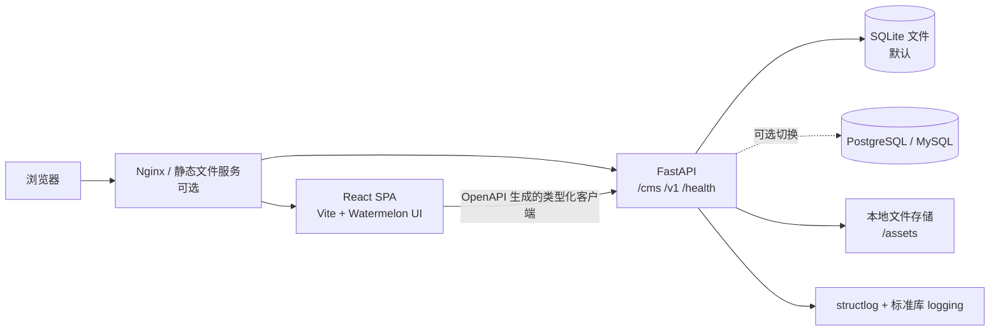
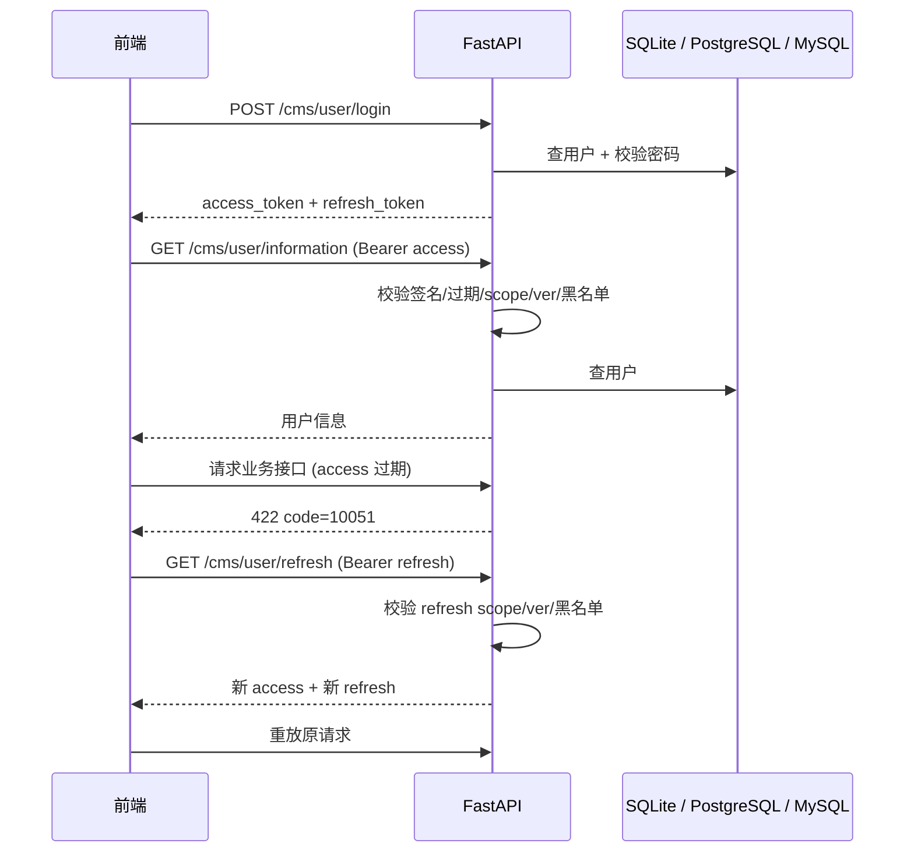
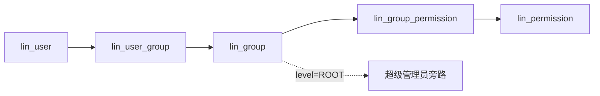
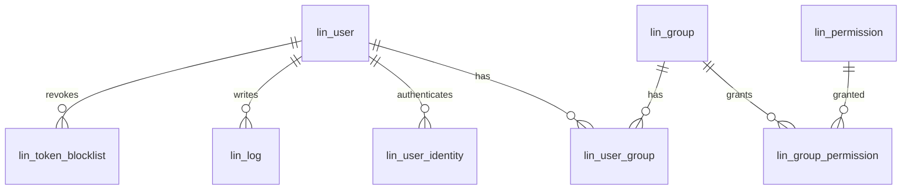
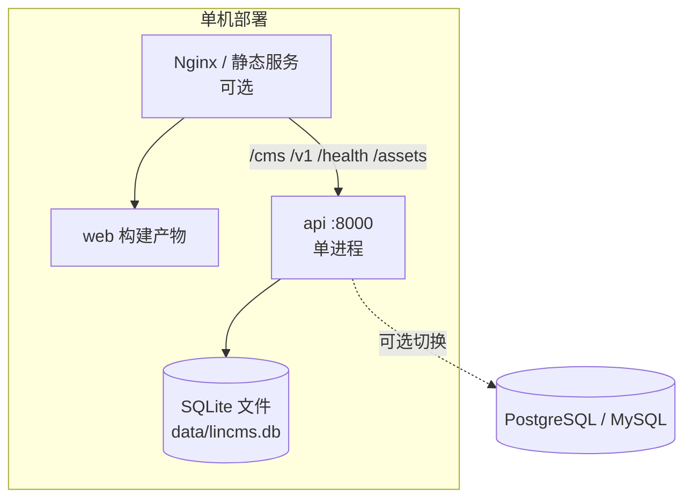

# Lin CMS 重构：规划计划书

> 文档版本：v0.1（待评审）  
> 日期：2026-10-19  
> 版本核验日期：2026-10-19（PyPI / npm / endoflife.date / python.org / nodejs.org）  
> 依据：[需求澄清](./00-requirements-clarification.md)、旧 Lin CMS Flask/Vue 实现（契约基线，参考仓库已于 2026-10-20 移除）、Watermelon UI 文档  
> 本文同时作为架构设计规格（Spec）。评审通过后进入[实现实施方案](./02-implementation-plan.md)。

## 1. 架构总览



设计原则：

1. **契约优先**：先冻结 API 契约，再并行开发前后端；TypeScript 类型由 OpenAPI 生成。
2. **分层清晰**：路由层只做协议转换，业务规则在 service，数据访问在 repository，模型不承担流程编排。
3. **显式权限**：每个受保护路由声明权限元信息；启动时同步数据库；Root 组按 `level=ROOT` 判定。
4. **零外部中间件**：不引入 Redis、消息队列、外部缓存或搜索服务；限流在进程内，令牌黑名单在数据库，文件在本地，数据库默认 SQLite 文件。
5. **保留旧契约的“线格式”**：路径、字段、分页、错误码、成功码保持不变，避免迁移期间双端同时大改。

### 1.1 版本与依赖基线（2026-10-19 核验）

- 所有依赖使用 **latest stable（正式版）**；不使用 alpha、beta、rc、next、canary。
- 初始化时按本节表格锁定精确版本，并提交 `uv.lock` 与 `pnpm-lock.yaml`；若初始化当天出现更新的正式补丁版，升级到该补丁版并同步更新本表。
- CI 使用 `uv sync --frozen` 与 `pnpm install --frozen-lockfile`；禁止依赖版本漂移。
- 每月检查一次更新；安全补丁立即升级；跨大版本升级单独 PR，并跑全量测试与契约测试。
- Watermelon/shadcn 组件是复制式分发，没有 npm 版本号；在 `components.lock.json` 记录 registry URL、拉取日期和文件 sha256。
- shadcn CLI 带入的依赖若与本节版本不一致，以本节为准覆盖安装并更新锁文件。
- 若最新大版本与生态不兼容，回退到“最新可用的稳定版”，并在 ADR 记录原因；不回退到预发布版。

| 类别 | 依赖 | 锁定版本 |
| --- | --- | --- |
| 运行时 | Python | 3.15.0 |
| 运行时 | Node.js | 24.22.0 LTS |
| 工具 | pnpm | 12.14.0 |
| 工具 | uv | 0.13.1 |
| 后端 | FastAPI | 0.148.0 |
| 后端 | Pydantic | 2.14.1 |
| 后端 | SQLAlchemy | 2.1.5 |
| 后端 | Alembic | 1.20.0 |
| 后端 | PyJWT | 2.15.1 |
| 后端 | python-multipart | 0.0.32 |
| 后端 | Uvicorn | 0.54.0 |
| 后端测试 | pytest | 9.1.1 |
| 后端测试 | httpx | 0.28.1 |
| 后端质量 | Ruff | 0.17.1 |
| 后端质量（可选） | mypy | 2.4.0 |
| 数据库 | SQLite | 3.54.1 |
| 数据库（可选） | PostgreSQL | 18.6 |
| 数据库（可选） | MySQL | 9.7.2 LTS |
| 数据库驱动（可选） | psycopg2-binary | 2.9.13 |
| 数据库驱动（可选） | PyMySQL | 1.2.3 |
| 验证码（可选） | Pillow | 13.0.0 |
| 前端 | React / React DOM | 19.3.1 |
| 前端 | React Router | 8.5.0 |
| 前端 | TypeScript | 7.0.2 |
| 前端 | Vite | 8.3.4 |
| 前端 | @vitejs/plugin-react | 6.1.2 |
| 前端 | Tailwind CSS | 4.3.3 |
| 前端 | @tailwindcss/vite | 4.3.3 |
| 前端 | lucide-react | 1.59.0 |
| 前端 | clsx | 2.1.1 |
| 前端 | tailwind-merge | 3.7.0 |
| 前端 CLI | shadcn | 4.22.1 |
| 前端 CLI | create-vite | 9.3.0 |
| 前端质量 | @biomejs/biome | 2.5.15 |
| 前端测试 | Vitest | 5.0.5 |
| 前端测试 | @testing-library/react | 16.3.3 |
| 前端测试 | jsdom | 30.1.3 |
| 前端契约 | openapi-typescript | 7.13.0 |
| 前端 E2E | @playwright/test | 1.64.1 |
| 后端第三方 | argon2-cffi | 25.1.0 |
| 后端第三方 | structlog | 26.1.0 |
| 前端状态 | @tanstack/react-query | 5.104.4 |
| 前端表格 | @tanstack/react-table | 9.3.1 |
| 前端状态 | zustand | 5.0.15 |
| 前端表单 | react-hook-form | 7.90.0 |
| 前端表单 | zod | 4.6.7 |
| 前端表单 | @hookform/resolvers | 6.0.0 |
| 前端 HTTP | openapi-fetch | 0.17.0 |
| 前端动画 | motion | 14.4.0 |
| 前端图表 | recharts | 3.10.1 |
| 前端通知 | sonner | 2.0.8 |
| 前端日期 | date-fns | 4.4.0 |
| 前端日期 | react-day-picker | 10.0.2 |
| 前端图片 | react-easy-crop | 6.2.4 |
| 前端组件工具 | class-variance-authority | 0.7.1 |
| 前端组件（command） | cmdk | 1.1.1 |
| 前端测试 | msw | 3.0.3 |

> Node 采用最新 LTS（24.22.0）；26.12.0 为 Current，不作为生产基线。
>
> 版本核验以 2026-10-19 各官方 registry 的 `latest` 标签为准；初始化时若出现更新的正式补丁版，升级到该补丁版并更新本表与锁文件。未列出的传递依赖由锁文件固定为安装当天的 latest stable；不使用任何预发布版本。第三方库不受“零外部中间件”约束。

## 2. 技术选型

### 2.1 后端

| 领域 | 选择 | 锁定版本 | 理由 | 备选 |
| --- | --- | --- | --- | --- |
| 语言 | Python | 3.15.0 | 与 FastAPI 生态匹配，类型能力完善 | 3.14 |
| Web 框架 | FastAPI（同步路由，线程池执行） | 0.148.0 | 原生 Pydantic/OpenAPI；同步 DB 更简单 | Litestar |
| 数据校验 | Pydantic | 2.14.1 | FastAPI 内置依赖，不额外引入 | attrs + cattrs |
| ORM | SQLAlchemy（同步） | 2.1.5 | 一套 ORM 适配 SQLite/PostgreSQL/MySQL | SQLModel（封装过重） |
| 迁移 | Alembic | 1.20.0 | SQLAlchemy 官方方案，支持 batch 模式 | 手写 SQL |
| 数据库 | SQLite 3（标准库驱动） | 3.54.1 | 零外部服务、单文件、备份简单；SQLAlchemy 可适配 PostgreSQL/MySQL 等主流库 | PostgreSQL 18.6 / MySQL 9.7.2 LTS（可选） |
| 数据库驱动 | 标准库 `sqlite3`；可选 `psycopg2-binary` / `PyMySQL` | 2.9.13 / 1.2.3 | 默认零额外驱动 | asyncpg / aiomysql |
| 文件上传 | python-multipart | 0.0.32 | FastAPI 文件上传必需 | — |
| JWT | PyJWT | 2.15.1 | 轻量、成熟；手写 JWT 风险高 | python-jose |
| 密码哈希 | Argon2id（argon2-cffi）+ 旧 scrypt 兼容 | 25.1.0 | 现代密码 KDF；登录时升级旧哈希 | 仅 scrypt（保留兼容分支） |
| 限流 | 自研进程内计数器 | stdlib | 单机中小型足够，无 Redis | slowapi（内存存储） |
| 日志 | structlog + 标准库 logging | 26.1.0 | 结构化、易接入采集；仍是库而非独立服务 | 标准库 logging + JSON Formatter |
| 验证码 | 默认关闭；开启时用 Pillow 生成 PNG | 13.0.0（可选） | 默认零依赖；PNG 不暴露可解析文本 | SVG / 纯文本 |
| 测试 | pytest + httpx TestClient | 9.1.1 / 0.28.1 | 同步测试，无需 pytest-asyncio | unittest |
| 质量 | Ruff（mypy 可选） | 0.17.1 / 2.4.0 | 一个工具完成 lint + format | flake8 + black + isort |
| 服务器 | Uvicorn（单进程） | 0.54.0 | 与 SQLite 单写者模型匹配 | Gunicorn 多 worker |

### 2.2 前端

| 领域 | 选择 | 锁定版本 | 理由 | 备选 |
| --- | --- | --- | --- | --- |
| 框架 | React / React DOM | 19.3.1 | Watermelon UI 的目标框架 | Preact |
| 语言 | TypeScript（`strict`） | 7.0.2 | 契约类型安全 | JavaScript |
| 构建 | Vite + @vitejs/plugin-react | 8.3.4 / 6.1.2 | 快速、配置简单 | Next.js（本项目不需要 SSR） |
| 样式 | Tailwind CSS + @tailwindcss/vite | 4.3.3 | shadcn/Watermelon 基础 | CSS Modules |
| 样式工具 | clsx + tailwind-merge | 2.1.1 / 3.7.0 | shadcn `cn` 依赖 | 自研 className 合并 |
| 组件 | shadcn CLI + Watermelon UI | CLI 4.22.1；Watermelon 走 registry | 源码可控、可定制 | Ant Design / MUI |
| 路由 | React Router | 8.5.0 | 成熟、支持嵌套路由与守卫 | TanStack Router |
| 服务端状态 | TanStack Query | 5.104.4 | 缓存、失效、重试、并发控制成熟，减少自研 hooks | SWR |
| 客户端状态 | Zustand + persist | 5.0.15 | 轻量，适合认证/主题/页签 | Redux Toolkit |
| 表单 | React Hook Form + Zod + @hookform/resolvers | 7.90.0 / 4.6.7 / 6.0.0 | 性能好、类型推导强，与 shadcn Form 配套 | TanStack Form |
| HTTP | openapi-fetch | 0.17.0 | 类型来自 OpenAPI，零手写 DTO | Axios |
| 契约类型 | openapi-typescript | 7.13.0 | 由 OpenAPI 生成 TS 类型 | 手写类型 |
| 动画 | Motion | 14.4.0 | Watermelon 动画组件常见依赖；仅在需要交互动画时使用 | CSS transition |
| 图表 | Recharts | 3.10.1 | 与 shadcn chart 生态一致，工作台趋势图 | ECharts |
| 表格 | TanStack Table + shadcn `Table` | 9.3.1 | 无头、可组合，用户/日志/图书表格复用 | shadcn Table 手写 |
| 图标 | Lucide React | 1.59.0 | shadcn 生态默认，按需 tree-shaking | 内联 SVG |
| 头像裁剪 | react-easy-crop | 6.2.4 | 交互式裁剪、触摸友好 | 原生 Canvas |
| 通知 | Sonner | 2.0.8 | 轻量、可访问，与 shadcn 生态一致 | 自研 Toast |
| 日期 | date-fns + react-day-picker | 4.4.0 / 10.0.2 | 函数式、Tree-shaking；配合日历选择器 | dayjs |
| 测试 | Vitest + Testing Library + jsdom + MSW + Playwright | 5.0.5 / 16.3.3 / 30.1.3 / 3.0.3 / 1.64.1 | MSW 统一模拟 HTTP，组件与 E2E 分离 | Jest + Cypress |
| 质量 | Biome + `tsc --noEmit` | 2.5.15 / 7.0.2 | 一个工具完成 lint + format | ESLint + Prettier |

### 2.3 工程与基础设施

| 领域 | 选择 |
| --- | --- |
| 运行时 | Node.js 24.22.0 LTS、Python 3.15.0 |
| 仓库形态 | 单一 monorepo：`lin-cms-fastapi/`、`lin-cms-react/`、`lin-cms-cli/`、`contracts/`、`docs/`；工作区根目录为唯一 git 仓库（工程名目录承担规划稿 `apps/api`、`apps/web` 的角色，不使用 submodule） |
| Python 包管理 | uv 0.13.1 + `pyproject.toml` |
| 前端包管理 | pnpm 12.14.0 |
| 任务编排 | 根目录 `Makefile`（`make dev`、`make test`、`make lint`） |
| 容器 | 可选：Docker Compose 仅含 api + web；默认直接本机运行 |
| CI | GitHub Actions |
| 反向代理 | 可选：Nginx；默认 FastAPI 托管构建后的静态文件 |

### 2.4 依赖预算

默认不引入需要独立部署的中间件；第三方库使用成熟方案，精确版本见 1.1。数据库驱动、PostgreSQL/MySQL 支持、E2E 等按需启用。

| 端 | 默认直接依赖 | 说明 |
| --- | --- | --- |
| 后端 | `fastapi`、`uvicorn`、`sqlalchemy`、`alembic`、`pyjwt`、`python-multipart`、`argon2-cffi`、`structlog` | SQLite 用标准库；限流与数据库黑名单不依赖外部服务 |
| 后端可选 | `psycopg2-binary`（PostgreSQL）、`PyMySQL`（MySQL）、`Pillow`（验证码） | 仅切换数据库或开启验证码时安装 |
| 前端运行时 | `react`、`react-dom`、`react-router`、`@tanstack/react-query`、`zustand`、`react-hook-form`、`zod`、`@hookform/resolvers`、`openapi-fetch`、`@tanstack/react-table`、`lucide-react`、`sonner`、`date-fns`、`react-day-picker`、`recharts`、`clsx`、`tailwind-merge` | 均为应用内库；shadcn/Watermelon 组件以源码复制 |
| 前端按需 | `motion`、`react-easy-crop` | 仅当使用的 Watermelon 组件需要动画，或需要头像裁剪时安装 |
| 前端构建/质量 | `vite`、`@vitejs/plugin-react`、`typescript`、`tailwindcss`、`@tailwindcss/vite`、`@biomejs/biome`、`vitest`、`@testing-library/react`、`jsdom`、`msw`、`openapi-typescript` | 均为开发依赖 |
| 前端 E2E | `@playwright/test` | 仅开发依赖，运行 E2E 时安装 |
| 明确不使用 | 需要独立部署的 Redis、Kafka、RabbitMQ、Celery、外部缓存/搜索服务 | 第三方库正常使用；只去掉独立中间件 |

> shadcn/Watermelon 组件按需引入 `@radix-ui/*`、`class-variance-authority` 等其自身必需的小包；只安装实际使用的组件，不引入完整组件库。

## 3. 目标仓库结构

```text
lin-cms/                            # 唯一 git 仓库（monorepo）
├── lin-cms-fastapi/                # 新后端（承担规划稿 apps/api 的角色）
│   ├── app/                        # main.py + core/ + api/routers/ + models/ + schemas/ + repositories/ + services/ + db/
│   ├── alembic/                    # 数据库迁移（SQLite batch 模式）
│   ├── tests/                      # pytest + httpx
│   ├── scripts/                    # export_openapi.py 导出契约
│   ├── data/、assets/              # 运行时 SQLite 与上传文件，不进入版本库
│   ├── pyproject.toml、uv.lock、.env.example
│   └── Dockerfile（可选）
├── lin-cms-react/                  # 新前端（承担规划稿 apps/web 的角色）
│   ├── src/
│   │   ├── components/             # ui/（shadcn + Watermelon 复制进来的组件）+ layout/
│   │   ├── features/               # auth/ dashboard/ users/ groups/ logs/ books/ profile/ …
│   │   ├── lib/                    # api/（客户端与类型）、auth/、permissions/、utils
│   │   ├── stores/、styles/、main.tsx
│   ├── tests/（含 e2e/）
│   └── components.json、package.json、.env.example
├── lin-cms-cli/                    # 本机 CLI（Go，2026-10 增量）：stdio MCP 桥 + 系统凭证库
├── contracts/
│   └── openapi.json                # 后端导出的冻结契约
├── docs/                           # 00–05 规划/实施/Agent 接入 + ui-design-book
└── README.md、AGENTS.md、.gitignore
```

2026-10-20 起工作区根目录初始化为唯一 git 仓库；旧 `lin-cms-flask`、`lin-cms-vue` 参考仓库已移除，契约以本文档与 `contracts/openapi.json` 为准，如需逐行对照可从 Lin CMS 公开 GitHub 仓库重新获取。

## 4. 后端详细设计

### 4.1 分层职责

| 层 | 职责 | 禁止 |
| --- | --- | --- |
| Router | 解析请求、声明权限、调用 service、返回 schema | 写 SQL、编排事务 |
| Service | 业务规则、事务边界、跨仓储编排 | 依赖 FastAPI Request |
| Repository | 查询构造、持久化、软删除过滤 | 业务判断 |
| Model | 表结构与关系 | 序列化逻辑 |
| Schema | 请求/响应模型与校验 | 数据库访问 |

### 4.2 配置

使用 `pydantic-settings`，环境变量前缀 `LIN_`，同时兼容旧变量名：

| 变量 | 默认值 | 说明 |
| --- | --- | --- |
| `LIN_ENV` | `development` | development/test/production |
| `LIN_SECRET_KEY` | 无（必填） | JWT 与验证码签名 |
| `LIN_DATABASE_URL` | `sqlite:///./data/lincms.db` | 默认 SQLite 文件（相对启动目录）；可改为 `postgresql+psycopg2://...` 或 `mysql+pymysql://...` |
| `LIN_SQLITE_BUSY_TIMEOUT` | `5000` | SQLite 写锁等待毫秒数 |
| `LIN_SQLITE_WAL` | `true` | 启用 WAL 提升读写并发 |
| `LIN_CORS_ORIGINS` | `http://localhost:5173` | 逗号分隔 |
| `LIN_ACCESS_TOKEN_TTL` | `3600` | 秒 |
| `LIN_REFRESH_TOKEN_TTL` | `604800` | 秒（7 天） |
| `LIN_LOGIN_CAPTCHA` | `false` | 验证码开关 |
| `LIN_UPLOAD_DIR` | `./assets` | 上传根目录 |
| `LIN_UPLOAD_SINGLE_LIMIT` | `2097152` | 单文件 2 MB |
| `LIN_UPLOAD_TOTAL_LIMIT` | `20971520` | 单请求 20 MB |
| `LIN_UPLOAD_MAX_FILES` | `10` | 文件数量上限 |
| `LIN_UPLOAD_EXTENSIONS` | `jpg,jpeg,png` | 允许扩展名 |
| `LIN_SITE_DOMAIN` | 空 | 为空时按请求 Host 生成绝对 URL |
| `LIN_RATE_LIMIT_ENABLED` | `true` | 限流开关 |
| `LIN_TRUST_PROXY` | `false` | 为 true 时才信任 `X-Forwarded-For` 计算客户端 IP |
| `LIN_LOG_LEVEL` | `INFO` | 日志级别 |
| `LIN_BOOTSTRAP_ADMIN_PASSWORD` | 开发/测试为 `123456`，生产必填 | 首次初始化 root 用户的密码；生产禁止使用默认值 |

### 4.3 鉴权与会话



实现要点：

- JWT 使用 HS256；claims：`sub=用户ID`、`type=access|refresh`、`ver=token_version`、`scope=lin`、`iat`、`exp`、`jti`。
- access 1 小时，refresh 7 天；两者都不可用于对方的接口。
- `token_version` 在改密、管理员重置密码时 +1；校验时与数据库比较，不一致即 401。
- 登出：把 access 的 `jti` 写入 `lin_token_blocklist`；请求体带 `refresh_token` 时一并写入。过期记录在写入时顺带清理。
- 黑名单只使用数据库表，不引入 Redis；每次请求按 `jti` 查询，命中即拒绝。
- 密码：新密码使用 Argon2id（`argon2-cffi`，参数采用库默认值）；登录时识别 Werkzeug 的 `scrypt:参数$salt$hash` 格式并兼容校验，校验成功后自动重哈希为 Argon2id。
- 密码策略保持 6–22 位、无复杂度要求。
- 登录按 `username` 查询用户；用户为硬删除，不存在“同名已删除记录遮蔽新用户”的问题。
- 登录限流 60 次/分钟；刷新/登出/验证码各 60 次/分钟；注册 30 次/小时。键为客户端 IP；仅当 `LIN_TRUST_PROXY=true` 时读取 `X-Forwarded-For` 的最左可信地址，避免伪造头绕过限流。
- 限流使用进程内计数器（`threading.Lock` 保护 + 过期清理），默认单进程运行；多 worker 时限额按进程独立计数，属于已知限制。
- 验证码默认关闭；开启时 `GET/POST /cms/user/captcha` 返回 `{tag, image}`；`image` 为 `data:image/png;base64,...`（Pillow 为可选依赖），验证码为 4 位数字；`tag` 为含验证码与 5 分钟过期的 JWT；登录请求头带 `tag`，请求体带 `captcha`。关闭时返回 `{tag:"", image:""}`。
- 路由使用同步 `def`（或在线程池中执行同步 DB），避免异步驱动与事件循环阻塞问题；中小型规模下吞吐足够。

#### 4.3.1 SQLite 运行参数与限制

- 连接参数：`PRAGMA journal_mode=WAL`、`PRAGMA foreign_keys=ON`、`PRAGMA busy_timeout=5000`、`PRAGMA synchronous=NORMAL`。
- 连接使用 `check_same_thread=False`（FastAPI 线程池会跨线程使用连接），每个请求一个 Session，事务结束即释放。
- SQLite 同一时刻只有一个写者；默认 Uvicorn 单进程运行，写操作通过事务串行化。读操作在 WAL 模式下可并发。
- 备份：停止写入后复制数据库文件，或使用 `VACUUM INTO 'backup.db'`；上传目录单独备份。
- 应用启动时自动创建 `data/` 目录；数据库文件权限设置为仅服务账号可读写（`0600`）。
- 迁移使用 Alembic `render_as_batch=True`，兼容 SQLite 的 ALTER 能力。
- 切换 PostgreSQL/MySQL 只需修改 `LIN_DATABASE_URL` 并安装对应驱动；业务代码不写方言 SQL。

### 4.4 权限模型与同步



规则：

- `lin_group.level`：1=ROOT，2=GUEST，3=USER；Root/Guest 各只允许一条。
- 用户可属于多个分组；权限为分组权限并集。
- 权限元信息由路由声明：`PermissionMeta(name, module, mount)`。
- 应用启动时执行幂等同步：
  1. 代码有、数据库无 → 插入；
  2. 两边都有但 `mount` 不同 → 更新；
  3. 数据库有、代码无 → 删除，并清理分组关联。
- 仅 `mount=True` 的权限出现在“可分配权限”清单中，并可被 `group_required` 校验。
- `admin_required`：当前用户任一所属分组 `level=ROOT`。
- `permission_required(name, module)`：Root 直接放行；否则要求用户所属分组集合中存在同名同模块且 `mount=True` 的权限。
- 无分组用户访问权限接口返回 401，消息“权限不够，请联系超级管理员获得权限”。

权限清单（必须与旧实现同名同模块）：

| 模块 | 权限名 | mount | 保护接口 |
| --- | --- | --- | --- |
| 用户 | 注册 | false | `POST /cms/user/register`（实际由 Root 保护） |
| 用户 | 用户更新信息 | false | `PUT /cms/user` |
| 用户 | 修改密码 | false | `PUT /cms/user/change_password` |
| 用户 | 查询自己信息 | false | `GET /cms/user/information` |
| 用户 | 刷新令牌 | false | `GET /cms/user/refresh` |
| 用户 | 退出登录 | false | `POST /cms/user/logout` |
| 用户 | 查询自己拥有的权限 | false | `GET /cms/user/permissions` |
| 用户 | 获取图形验证码 | false | `GET/POST /cms/user/captcha` |
| 管理员 | 查询所有可分配的权限 | false | `GET /cms/admin/permission` |
| 管理员 | 查询所有用户 | false | `GET /cms/admin/users` |
| 管理员 | 修改用户密码 | false | `PUT /cms/admin/user/{uid}/password` |
| 管理员 | 删除用户 | false | `DELETE /cms/admin/user/{uid}` |
| 管理员 | 管理员更新用户信息 | false | `PUT /cms/admin/user/{uid}` |
| 管理员 | 查询所有分组 | false | `GET /cms/admin/group/all` |
| 管理员 | 查询一个分组及其权限 | false | `GET /cms/admin/group/{gid}` |
| 管理员 | 新建分组 | false | `POST /cms/admin/group` |
| 管理员 | 更新一个分组 | false | `PUT /cms/admin/group/{gid}` |
| 管理员 | 删除一个分组 | false | `DELETE /cms/admin/group/{gid}` |
| 管理员 | 分配多个权限 | false | `POST /cms/admin/permission/dispatch/batch` |
| 管理员 | 删除多个权限 | false | `POST /cms/admin/permission/remove` |
| 日志 | 查询日志 | true | `GET /cms/log` |
| 日志 | 搜索日志 | true | `GET /cms/log/search` |
| 日志 | 查询日志记录的用户 | true | `GET /cms/log/users` |
| 图书 | 删除图书 | true | `DELETE /v1/book/{id}` |

> 实现中必须保持“权限名 + 模块”组合唯一；`mount` 变更只更新不重建，避免丢失分组授权。

### 4.5 数据模型



| 表 | 字段 | 约束/索引 |
| --- | --- | --- |
| `lin_user` | id, username(24), nickname(24), avatar(500), email(100, nullable), token_version(int, default 0), create_time, update_time | `username` 唯一；`email` 唯一（空邮箱存 NULL） |
| `lin_user_identity` | id, user_id, identity_type(100), identifier(100), credential(255), create_time, update_time | `user_id` 索引 |
| `lin_user_group` | id, user_id, group_id | 唯一 `(user_id, group_id)` |
| `lin_group` | id, name(60), info(255), level(smallint, default 3), create_time, update_time, deleted_at, deleted_token(int, default 0) | 唯一 `(name, deleted_token)` |
| `lin_permission` | id, name(60), module(50), mount(bool), create_time, update_time | 唯一 `(name, module)`；同步时硬删除过期项 |
| `lin_group_permission` | id, group_id, permission_id | 唯一 `(group_id, permission_id)` |
| `lin_token_blocklist` | id, jti(64), user_id, expires_at, create_time | `jti` 唯一；`expires_at` 索引 |
| `lin_log` | id, message(450), user_id, username(24), status_code, method(20), path(50), permission(100), create_time | `create_time`、`username` 索引；追加写，不软删除 |
| `lin_file` | id, path(500), type(10, default LOCAL), name(100), extension(50), size, md5(40), create_time, update_time, deleted_at, deleted_token(int, default 0) | 唯一 `(md5, deleted_token)` |
| `lin_book` | id, title(50), author(30), summary(1000), image(100), create_time, update_time, deleted_at, deleted_token(int, default 0) | `title` 索引；唯一不需要 |

删除与唯一性约定：

- 用户删除为**硬删除**：同时清理 `lin_user_group` 与 `lin_user_identity`。
- 分组、图书、文件使用软删除：`deleted_token=0` 表示活跃，删除时设为该行 `id`，`deleted_at` 记录时间。
- 唯一约束使用 `(业务键, deleted_token)`，不依赖 PostgreSQL 部分索引；SQLite、PostgreSQL、MySQL 行为一致。
- 权限同步时硬删除已移除的权限，并级联清理 `lin_group_permission`。
- 日志追加写，不做软删除；按保留策略定期清理旧记录。
- 所有查询默认过滤 `deleted_token=0`（仅对含该列的表）。

跨数据库可移植性规则：

- 只使用 SQLAlchemy 通用类型：`Integer`、`String(n)`、`Text`、`Boolean`、`DateTime`。
- 不使用数据库特有语法、部分索引、`ON CONFLICT` 方言、原生 JSON 查询。
- 时间统一存 UTC，展示时由前端转换。
- 主键使用 `Integer` 自增；不使用 SQLite 的 `AUTOINCREMENT` 关键字。
- 迁移使用 Alembic；SQLite 使用 batch 模式。
- 默认 CI 跑 SQLite；可选矩阵跑 PostgreSQL/MySQL，验证同一套模型与迁移。

### 4.6 响应契约

#### 4.6.1 信封响应

用于“操作成功/失败”类接口：

```json
{
  "message": "用户创建成功",
  "code": 0,
  "request": "POST  /cms/user/register"
}
```

- `message` 为中文提示；`code` 为业务码；`request` 为“方法 + 两个空格 + 无查询串路径”。
- 在 OpenAPI 中为信封响应声明 `ApiMessage` 模型，字段固定为 `code`、`message`、`request`，供前端生成类型。
- HTTP 状态码独立于业务码：成功 200，参数错误 400，未认证/无权限 401，资源不存在 404，令牌过期 422，限流 429，服务器错误 500。
- 前端判断成功使用 `code < 9998`（与旧前端 `MAX_SUCCESS_CODE` 语义一致）。

#### 4.6.2 数据响应

查询类接口直接返回业务对象，不套信封：

- 登录：`{ "access_token": "...", "refresh_token": "..." }`
- 分页：`{ "items": [], "count": 5, "page": 0, "total": 0, "total_page": 0 }`
- 用户信息：`{ "id", "username", "nickname", "email", "avatar" }`
- 分组：`{ "id", "name", "info", "level" }`
- 权限：`{ "id", "name", "module", "mount" }`
- 权限信息：用户字段 + `{ "admin": true, "permissions": [{ "模块": [{ "permission", "module" }] }] }`
- 图书：`{ "id", "title", "author", "image", "summary" }`
- 日志：`{ "id", "message", "user_id", "username", "status_code", "method", "path", "permission", "create_time", "time" }`，`create_time` 为 UTC 的 `YYYY-MM-DDTHH:MM:SSZ`，`time` 为毫秒时间戳，兼容旧前端。
- 文件：`[{ "key", "id", "path", "url" }]`

> 明确不返回 `token_version` 等内部字段；这是相对旧实现的收敛，不影响任何现有前端逻辑。

#### 4.6.3 错误码

| code | HTTP | 含义 |
| --- | --- | --- |
| 0 | 200 | 成功 |
| 12 / 13 / 14 | 200 | 新建/更新/删除图书成功 |
| 9999 | 500 | 服务器未知错误 |
| 10000 | 401 | 未携带令牌（保留；旧实现通常返回 10010） |
| 10010 | 401 | 认证失败 / 授权失败 |
| 10012 | 401 | 认证头字段解析失败 |
| 10020 | 404 | 资源不存在（保留；旧实现未实际使用） |
| 10021 | 404 | 用户不存在 / 书籍不存在（旧实现共用此码） |
| 10022 | 404 | 保留（旧消息表定义，当前未使用） |
| 10025 | 404 | 路由不存在 |
| 10030 | 400 | 参数错误 |
| 10040 | 401 | 令牌失效 |
| 10041 | 401 | access token 损坏 |
| 10042 | 401 | refresh token 损坏 |
| 10050 | 401 | 令牌过期（保留） |
| 10051 | 422 | access token 过期 |
| 10052 | 400 | refresh token 过期 / 刷新失败 |
| 10060 | 400 | 字段重复 |
| 10070 | 401 | 禁止操作 |
| 10073 | 401 | Root 分组不可添加用户 |
| 10076 | 400 | 邮箱已被使用 |
| 10077 | 401 | 不可将用户分配给不存在的分组 |
| 10078 | 401 | 不可修改 Root 用户分组 |
| 10080 | 405 | 请求方法不允许（旧实现为 401，属于修正） |
| 10110 | 413 | 文件体积过大 |
| 10120 | 413 | 文件数量过多 |
| 10130 | 401 | 文件扩展名不符合规范 |
| 10140 | 429 | 请求过于频繁 |
| 10150 | 400 | 丢失参数 |
| 10200 | 400 | 业务失败（如密码错误） |

FastAPI 默认的 422 校验错误必须被异常处理器转换为 `400 + code 10030 + message`，否则旧前端与契约测试会失败。

### 4.7 完整 API 契约

通用约定：

- `Auth`：`Public` 无认证；`Login` 任意有效 access token；`Root` 必须属于 ROOT 组；`Permission` 按表中权限校验；`Refresh` 必须使用 refresh token。
- 分页 `count` 默认 5，范围 `1..15`；`page` 从 0 开始。
- 所有路径保持旧前缀，不新增 `/api`。

| # | 方法 | 路径 | Auth | 请求 | 成功响应 |
| --- | --- | --- | --- | --- | --- |
| 1 | GET | `/health` | Public | — | `{status:"ok", version}` |
| 2 | POST | `/cms/user/login` | Public | `{username, password, captcha?}`；验证码开启时 Header `tag` | `{access_token, refresh_token}` |
| 3 | POST | `/cms/user/register` | Root | `{username, password, confirm_password, email?, group_ids?}` | 信封 `code=0` |
| 4 | PUT | `/cms/user` | Login | `{email?, nickname?, avatar?}` | 信封 `code=0` |
| 5 | PUT | `/cms/user/change_password` | Login | `{old_password, new_password, confirm_password}` | 信封 `code=0` |
| 6 | GET | `/cms/user/information` | Login | — | 用户对象 |
| 7 | GET | `/cms/user/refresh` | Refresh | — | `{access_token, refresh_token}` |
| 8 | POST | `/cms/user/logout` | Login | `{refresh_token?}` | 信封 `code=0` |
| 9 | GET | `/cms/user/permissions` | Login | — | 用户对象 + `admin` + 分组权限 |
| 10 | GET/POST | `/cms/user/captcha` | Public | — | `{tag, image}` |
| 11 | GET | `/cms/admin/permission` | Root | — | `{模块: [权限]}` |
| 12 | GET | `/cms/admin/users` | Root | `count, page, group_id?` | 分页用户 |
| 13 | PUT | `/cms/admin/user/{uid}/password` | Root | `{new_password, confirm_password}` | 信封 `code=0` |
| 14 | DELETE | `/cms/admin/user/{uid}` | Root | — | 信封 `code=0` |
| 15 | PUT | `/cms/admin/user/{uid}` | Root | `{email, group_ids}` | 信封 `code=0` |
| 16 | GET | `/cms/admin/group/all` | Root | — | 分组数组 |
| 17 | GET | `/cms/admin/group/{gid}` | Root | — | 分组 + `permissions` |
| 18 | POST | `/cms/admin/group` | Root | `{name, info?, permission_ids}` | 信封 `code=0` |
| 19 | PUT | `/cms/admin/group/{gid}` | Root | `{name, info?}` | 信封 `code=0` |
| 20 | DELETE | `/cms/admin/group/{gid}` | Root | — | 信封 `code=0` |
| 21 | POST | `/cms/admin/permission/dispatch/batch` | Root | `{group_id, permission_ids}` | 信封 `code=0` |
| 22 | POST | `/cms/admin/permission/remove` | Root | `{group_id, permission_ids}` | 信封 `code=0` |
| 23 | GET | `/cms/log` | Permission: 查询日志 | `count, page, name?, start?, end?` | 分页日志 |
| 24 | GET | `/cms/log/search` | Permission: 搜索日志 | `count, page, keyword?, name?, start?, end?` | 分页日志 |
| 25 | GET | `/cms/log/users` | Permission: 查询日志记录的用户 | — | `{items:[username]}` |
| 26 | POST | `/cms/file` | Login | multipart 文件字段 | `[{key,id,path,url}]` |
| 27 | GET | `/v1/book/{id}` | Public | — | 图书对象；不存在时 404/code 10021 |
| 28 | GET | `/v1/book` | Public | — | 图书数组 |
| 29 | GET | `/v1/book/search` | Public | `q` | 图书数组 |
| 30 | POST | `/v1/book` | Login | `{title, author, image, summary}` | 信封 `code=12` |
| 31 | PUT | `/v1/book/{id}` | Login | `{title, author, image, summary}` | 信封 `code=13` |
| 32 | DELETE | `/v1/book/{id}` | Permission: 删除图书 | — | 信封 `code=14` |

关键业务规则：

| 规则 | 行为 |
| --- | --- |
| 创建用户未传 `group_ids` | 自动加入 `level=GUEST` 的分组 |
| 用户名重复 | 400，code 10060，消息“用户名重复，请重新输入” |
| 邮箱重复 | 400；创建用户 code 10060，管理员更新 code 10030 |
| 删除 Root 用户 | 401，消息“无法删除此用户” |
| 删除 Root/Guest 分组 | 401，消息“不可删除此分组” |
| 删除有用户的分组 | 401，消息“分组下存在用户，不可删除” |
| 新建同名分组 | 401，消息“分组已存在，不可创建同名分组” |
| 向 Root 组添加用户 | 401，code 10073，消息“root分组不可添加用户” |
| 修改 Root 用户的分组 | 401，code 10078，消息“不可修改root用户的分组” |
| 分配不存在的分组 | 401，code 10077，消息“不可将用户分配给不存在的分组” |
| 分组详情 | 包含 `permissions`，仅 `mount=True` |
| 权限分配 | 幂等：已存在的关联不重复插入 |
| 权限回收 | 批量删除关联，不存在时也返回成功 |
| 日志时间参数 | 格式 `YYYY-MM-DD HH:MM:SS`，非法格式 400 |
| 日志关键字 | LIKE 查询必须转义 `%` 和 `_` |
| 图书删除 | 软删除；重复删除返回 404 |
| 文件重复 | 按 MD5 复用已有记录与 URL |
| Root 组用户列表 | `GET /cms/admin/users` 不返回仅属于 Root 组的用户 |

### 4.8 行为日志

在以下操作成功后写入 `lin_log`：

| 操作 | 模板 |
| --- | --- |
| 登录 | `{username}登录成功获取了令牌` |
| 创建用户 | `管理员新建了一个用户` |
| 修改自己的密码 | `{user.username}修改了自己的密码` |
| 删除用户 | `管理员删除了一个用户` |
| 新建分组 | `管理员新建了一个分组` |
| 删除分组 | `管理员删除了一个分组` |

> 旧实现的 `@Logger` 装饰器在视图 `raise Success(...)` 时不会执行 `write_log`，导致除登录外多数行为日志实际缺失。新实现改为在 service 成功提交后显式写入（或响应后钩子），并用测试确保注册、改密、删除用户、新建/删除分组均有日志。

日志字段：

- `message`：渲染后的中文描述；
- `user_id` / `username`：操作者；
- `status_code` / `method` / `path` / `permission`：请求上下文；
- `create_time`：服务器 UTC 时间。

请求访问日志与业务日志分离：访问日志使用 structlog（底层接标准库 logging）输出 JSON 到 stdout，敏感字段（password/token/secret 等）递归脱敏。

### 4.9 文件上传

- 上传目录：`LIN_UPLOAD_DIR/YYYY/MM/DD/<uuid>.<ext>`；
- 数据库存相对路径 `YYYY/MM/DD/<uuid>.<ext>`；
- 返回 `path` 为相对路径，`url` 为 `SITE_DOMAIN + /assets/ + path`（未配置域名时用请求 Host）；
- 校验顺序：是否有文件 → 扩展名 → 单文件大小 → 文件数量 → 总大小；
- MD5 去重：命中 `deleted_token=0` 的记录时直接复用；
- 同步路由通过 `UploadFile.file` 读取文件内容；
- 静态文件通过 FastAPI `StaticFiles` 挂载到 `/assets`；
- 只实现本地存储（`save/delete/url_for`），不引入 S3/OSS/COS/Qiniu SDK。

### 4.10 API 文档与契约产物

- FastAPI 自动生成 `/openapi.json`、`/docs`、`/redoc`；生产通过 `LIN_ENV=production` 关闭文档路由。
- 为旧书签提供兼容重定向：`/apidoc/openapi.json` → `/openapi.json`，`/apidoc/swagger/` → `/docs`（仅非生产环境）。
- CI 导出 `contracts/openapi.json`，与前端生成的 `schema.d.ts` 比对，不一致即失败。
- 前后端联调以 OpenAPI 为唯一事实来源。

## 5. 前端详细设计

### 5.1 路由与页面

| 路径 | 页面 | 权限 | 说明 |
| --- | --- | --- | --- |
| `/login` | 登录 | Public | 用户名/密码/可选验证码 |
| `/` | 重定向 | Login | 默认到 `/dashboard` |
| `/dashboard` | 工作台 | Login | 统计卡片、快捷入口、最近日志 |
| `/about` | 关于 | Login | 项目、技术栈、版本信息 |
| `/log` | 日志 | 查询日志/搜索日志/日志用户 | 筛选、搜索、高亮、加载更多 |
| `/center` | 个人中心 | Login | 昵称、邮箱、头像裁剪、改密 |
| `/book/list` | 图书列表 | Login | 表格、编辑、删除（权限控制） |
| `/book/add` | 新建图书 | Login | 表单 |
| `/book/edit/:id` | 编辑图书 | Login | 表单 |
| `/admin/user/list` | 用户列表 | Root | 分组筛选、分页、编辑弹窗、删除 |
| `/admin/user/add` | 新建用户 | Root | 用户表单 |
| `/admin/group/list` | 分组列表 | Root | 列表、编辑信息、删除 |
| `/admin/group/add` | 新建分组 | Root | 名称/描述/权限树 |
| `/admin/group/edit/:id` | 分组权限 | Root | 权限树差异保存 |
| `/404` | 404 | Public | 未匹配路由 |

> 旧菜单配置引用了不存在的权限名“查询所有日志”；新前端以实际权限名“查询日志 / 搜索日志 / 查询日志记录的用户”为准。
| `*` | 重定向 404 | Public | — |

路由守卫：

1. 无 access token 且目标非公开 → 跳转 `/login`。
2. 已登录访问 `/login` → 跳转 `/dashboard`。
3. 路由声明 `permission` 时，非管理员且无权限 → 跳转 `/404` 或显示无权限页。
4. 管理员（`admin=true`）旁路所有权限判断。

### 5.2 布局与交互

采用 Watermelon `agndex-dashboard` 作为后台壳参考，改造成 CMS 布局：

- **侧边栏**：Logo、菜单树、折叠/展开；移动端抽屉；侧边栏内搜索 + `Ctrl/Cmd+K` 命令面板（shadcn `Command`）。
- **顶栏**：面包屑、全局搜索、主题切换、全屏、用户菜单（个人中心/退出）。
- **多页签**：打开过的页面形成页签；支持关闭当前/其他/全部；刷新后恢复；上限 12 个。
- **主内容区**：页面标题、操作区、内容卡片。
- **响应式**：≥1280 桌面展开；768–1279 折叠；<768 抽屉。
- **空闲登出**：监听点击/键盘/滚动/触摸事件；默认 60 分钟无操作清理会话并回登录页；登录页不启用。
- **反馈**：Sonner 全局 toast；删除操作二次确认；表单错误就地展示。
- **加载**：路由级骨架屏；表格/卡片局部 skeleton；按钮提交 loading。
- **空状态**：统一 EmptyState 组件，区分“无数据”“无搜索结果”“无权限”。

### 5.3 状态管理

| 状态 | 方案 | 持久化 |
| --- | --- | --- |
| 服务端数据（用户、分组、日志、图书） | TanStack Query | 内存缓存，默认 staleTime 30s |
| 认证状态（user、admin、permissions） | Zustand + persist | localStorage：`lin-cms:auth` |
| Token | 内存 + localStorage | `lin-cms:access-token`、`lin-cms:refresh-token` |
| 主题 | Zustand + persist | localStorage：`lin-cms:theme` |
| 多页签 | Zustand + persist | sessionStorage：`lin-cms:tabs` |
| 表单 | React Hook Form + Zod | 不持久化 |

数据刷新约定：

| 资源 | Query Key | 失效时机 |
| --- | --- | --- |
| 当前用户 | `['me']` | 登录、改资料、改密 |
| 用户列表 | `['admin','users',{page,count,groupId}]` | 创建/更新/删除用户 |
| 分组列表 | `['admin','groups']` | 分组增删改 |
| 分组详情 | `['admin','group',gid]` | 权限变更 |
| 权限清单 | `['admin','permissions']` | 会话内长期缓存 |
| 日志 | `['logs',filters]` | 筛选变化；加载更多用 `useInfiniteQuery` |
| 图书列表 | `['books']` | 增删改 |
| 图书详情 | `['book',id]` | 编辑保存 |

### 5.4 API 客户端

- `openapi-typescript` 生成 `schema.d.ts`，放在 `src/lib/api/schema.d.ts`。
- 使用 `openapi-fetch` 创建类型化客户端，`baseUrl` 来自 `VITE_API_BASE_URL`，路径与 DTO 直接来自生成的 `schema.d.ts`。
- 请求处理：
  1. 自动附加 `Authorization: Bearer <access>`；
  2. 业务错误统一转换为 `ApiError { status, code, message, request }`；
  3. access token 过期（10041/10051）→ 单飞刷新 → 重放一次；
  4. refresh 失败（10000/10042/10050/10052/10012）→ 清理认证状态 → 跳登录；
  5. 无权限（10010/10070）→ toast + 可选跳 404。
- 刷新并发控制：模块级 `refreshPromise`，同一时刻只发一次刷新请求。
- mutation 成功后按 Query Key 精确失效；不做全量页面刷新。

### 5.5 表单与校验

| 表单 | 字段 | 规则 |
| --- | --- | --- |
| 登录 | username, password, captcha | 必填；验证码仅在开关开启时显示 |
| 新建用户 | username, email, password, confirmPassword, groupIds | 用户名 2–10 位字母/数字/下划线；密码 6–22；两次一致；邮箱格式；分组可多选，可为空（后端默认 Guest） |
| 编辑用户 | email, groupIds | 用户名只读；邮箱可编辑（后端支持，旧前端禁用，属于可用性修正）；分组可多选 |
| 重置密码 | newPassword, confirmPassword | 6–22；一致 |
| 分组 | name, info, permissionIds | 名称必填；权限可为空 |
| 图书 | title, author, image, summary | 全部必填；图片可为 URL 或上传结果 |
| 个人资料 | nickname, email, avatar | 昵称 2–10；邮箱格式 |
| 改密 | oldPassword, newPassword, confirmPassword | 6–22；新两次一致 |

校验使用 React Hook Form + Zod，schema 与后端 Pydantic schema 的字段名、长度、错误文案保持一致；提交前本地校验，服务端错误就地展示。邮箱使用保守正则校验，前后端规则一致。

### 5.6 权限 UI

```tsx
// 路由级
{ path: '/admin/users', permission: '超级管理员独有权限', element: <UserList /> }

// 组件级
<Can permission="删除图书">
  <Button variant="destructive">删除</Button>
</Can>

// Hook
const { isAdmin, can } = usePermission()
```

- 管理员 `admin=true` 直接返回 `true`。
- 权限集合来自 `/cms/user/permissions`，在登录后扁平化为 `Set<string>`。
- 侧边栏与路由使用同一份路由清单，避免“菜单可见但路由不可进”。

### 5.7 主题与设计系统

- 使用 Tailwind CSS 变量 + shadcn token；`components.json` 启用 `cssVariables`。
- 浅色/深色两套基础 token；4 套主色预设：
  - 海月靛青（默认）
  - 茶烟栗褐
  - 绛纱胭脂
  - 松岚黛绿
- 主题切换写入 `document.documentElement.dataset.theme` 与 `class="dark"`。
- 字号、圆角、阴影、间距使用统一 token；禁止页面内硬编码颜色。
- 工作台使用统计卡片 + Recharts 趋势图；图表颜色从主题 token 读取。

### 5.8 Watermelon UI 接入方式

Watermelon UI 以 shadcn 注册表分发，组件源码复制进项目，由本项目维护：

```bash
# 1. 创建 Vite + React + TS 工程（版本以 1.1 表为准）
pnpm dlx create-vite@9.3.0 lin-cms-react --template react-ts

# 2. 安装 Tailwind CSS 与 shadcn
pnpm add -D tailwindcss@4.3.3 @tailwindcss/vite@4.3.3
pnpm dlx shadcn@4.22.1 init

# 3. 在 lin-cms-react/components.json 中登记 Watermelon 注册表
# {
#   "registries": {
#     "@watermelon": "https://registry.watermelon.sh/r/{name}.json"
#   }
# }

# 4. 只安装后台壳作为布局参考，不安装动画/落地页区块
pnpm dlx shadcn@4.22.1 add @watermelon/agndex-dashboard

# 5. 安装实际使用的 shadcn 基础组件（含 form/sonner/command）
pnpm dlx shadcn@4.22.1 add button input label textarea form table dialog \
  dropdown-menu select checkbox tabs badge avatar sheet skeleton tooltip \
  sonner command calendar popover

# 6. 安装运行时库（精确版本，完整列表见 1.1）
pnpm add @tanstack/react-query@5.104.4 @tanstack/react-table@9.3.1 \
  zustand@5.0.15 react-hook-form@7.90.0 zod@4.6.7 @hookform/resolvers@6.0.0 \
  openapi-fetch@0.17.0 recharts@3.10.1 sonner@2.0.8 \
  date-fns@4.4.0 react-day-picker@10.0.2 react-easy-crop@6.2.4
# 如使用 Watermelon 动画组件，再安装 motion@14.4.0
# 开发依赖：msw@3.0.3、openapi-typescript@7.13.0 等见实施计划 T0.5
```

使用原则：

1. **复制而非依赖**：Watermelon 组件进入 `src/components/ui` 后视为项目代码，不随上游自动升级。
2. **只取所需**：只安装实际使用的组件/区块，避免整站模板带来冗余依赖。
3. **保留主题令牌**：将 Watermelon 的 demo 数据、品牌色替换为 CMS token。
4. **许可证合规**：Watermelon UI 为 MIT，复制文件保留来源与许可证说明（在 `NOTICE` 中记录）。
5. **可替换**：业务组件不直接依赖 Watermelon 专有 API，统一封装在 `components/ui` 之后。
6. **框架适配**：Watermelon 示例若使用 Next.js 的 `Link`/`Image`，复制后替换为 React Router 的 `Link` 与原生 ``；不引入 Next.js。
7. **按需裁剪**：若 dashboard 区块引入不需要的依赖，只保留 sidebar/topbar/layout 结构，删除 demo 页面、假数据与未使用组件。

### 5.9 Vue/Element Plus → React 组件映射

| 旧实现 | 新实现 |
| --- | --- |
| `el-table` | TanStack Table + shadcn `Table` |
| `el-form` / `el-form-item` | React Hook Form + Zod + shadcn `Form` |
| `el-dialog` | shadcn `Dialog` |
| `el-message` | Sonner |
| `el-message-box` | 自定义 `ConfirmDialog` |
| `el-dropdown` | shadcn `DropdownMenu` |
| `el-date-picker` | `Calendar` + `Popover`（react-day-picker）+ date-fns |
| `el-checkbox-group` | shadcn `Checkbox` + 权限树 |
| `el-menu` / 侧边栏 | Watermelon/shadcn `Sidebar` |
| `el-tabs` | shadcn `Tabs` |
| `el-pagination` | 自定义分页（保持 0-based 转换） |
| `el-upload` | 原生 `<input type="file">` + openapi-fetch 上传 mutation |
| `vue-picture-cropper` | `react-easy-crop` |
| `screenfull` | 原生 Fullscreen API |
| `v-permission` | `<Can>` / `usePermission` |
| Pinia persisted | Zustand persist + localStorage/sessionStorage |
| Vue Router | React Router |

## 6. 契约兼容与演进策略

### 6.1 兼容边界

必须兼容：

- HTTP 方法、路径、查询参数名、请求体字段名；
- 分页字段与 0-based 语义；
- 信封字段 `message`、`code`、`request`；
- 登录/刷新返回的 token 字段名；
- 权限分组的嵌套形状；
- 文件上传返回数组结构；
- 关键错误码。

允许改进（不破坏客户端）：

- 不返回 `token_version` 等内部字段；
- 错误消息统一为中文；
- 日志对象补充 `time`（毫秒时间戳）；
- 新增 `/dashboard` 所需数据由现有接口汇总，不新增后端契约；
- OpenAPI 文档与类型生成；
- 方法不允许返回 405（旧实现为 401）；
- 书籍不存在统一为 404/code 10021、消息“书籍不存在”；
- 管理员编辑用户时邮箱可编辑（旧前端禁用，后端本就支持）；
- Root 判定按分组 `level=ROOT`（旧实现按分组 ID）；
- 落实 Root 组/用户保护：Root 组不可添加用户，Root 用户不可修改分组；
- 修复行为日志缺失：旧 `@Logger` 在视图抛出 `Success` 时不写日志，新实现保证成功操作落库；
- 删除用户后可重建同名用户并正常登录；
- 删除用户时清理其身份认证记录，避免孤儿数据；
- 限流统一返回 429/code 10140（旧实现为 429/10220）；
- 未携带令牌统一返回 401/code 10010（旧消息表中的 10000 保留但不再使用）；
- 验证码保持 PNG data URI；Pillow 作为可选依赖，仅在开启验证码时安装，默认关闭；
- 图书列表为空返回 `[]`，不存在返回 404/code 10021；新前端不再依赖旧前端的 10020 分支；
- 日志“加载更多”以空 `items` 作为结束条件，不依赖 10020。

这些改进均在契约测试中显式断言，避免被误判为回归。

### 6.2 契约验证

1. **接口契约测试**：为 32 个接口建立成功/失败用例，断言状态码、`code`、关键字段。
2. **旧测试迁移**：旧 Flask 工程的用例已逐条迁移到 `lin-cms-fastapi/tests`，语义保持一致（映射见实施计划 4.3）。
3. **OpenAPI 快照**：CI 导出并比较 `contracts/openapi.json`，任何字段变更必须显式更新快照。
4. **前端类型检查**：`schema.d.ts` 重新生成后 `tsc --noEmit` 必须通过。
5. **E2E 对照**：Playwright 覆盖旧前端已有的主流程。
6. **旧前端兼容 smoke（已废弃）**：旧 Vue 参考仓库已移除；线格式兼容由契约测试与 Playwright E2E 保证。

### 6.3 兼容期与退役

- 新前端直接使用新后端，不保留旧 Vue 前端运行。
- 如需灰度：Nginx 按路径/来源把 `/cms/**`、`/v1/**` 切到新后端，静态资源仍由新前端提供。
- 旧 Flask 参考仓库已于 2026-10-20 移除；回滚以本仓库 git 历史与冻结契约为准。

## 7. 安全设计

| 威胁 | 控制 |
| --- | --- |
| 令牌泄露 | 短 access TTL、refresh 轮换、登出黑名单、改密全量失效 |
| 密码存储 | Argon2id（现代 KDF），不存明文；兼容旧 Werkzeug scrypt 并在登录后升级 |
| 暴力破解 | 进程内限流、可选验证码、失败消息不区分用户是否存在以外的信息 |
| 拒绝服务 | 单进程限流可挡住常规暴力尝试；如需多 worker，建议在反向代理层加限流 |
| 越权 | 路由级权限依赖 + 服务层二次校验；Root 按 level 判定 |
| SQL 注入 | SQLAlchemy 参数化；LIKE 关键字转义 |
| XSS | React 默认转义；禁止 `dangerouslySetInnerHTML`；日志高亮用文本分段而非 HTML |
| 文件上传攻击 | 扩展名白名单、大小/数量限制、UUID 文件名、静态目录禁止执行 |
| 敏感信息落日志 | 递归脱敏 password/token/secret 字段 |
| CORS | 显式白名单，不使用 `*` 配合凭据 |
| 密钥管理 | 仅环境变量/Secret，仓库只保留 `.env.example` |
| 依赖风险 | 锁定版本、CI 依赖审计、定期升级 |
| Token 存储 | 本期兼容旧契约使用 localStorage；生产配置严格 CSP，后续可迁移到 HttpOnly Secure Cookie |
| 数据库文件 | SQLite 文件权限 `0600`，放在非静态目录；上传目录禁止执行脚本 |

## 8. 测试策略

| 层级 | 范围 | 工具 | 目标 |
| --- | --- | --- | --- |
| 后端单元 | service、权限判断、密码/令牌工具 | pytest | 核心逻辑覆盖 ≥ 90% |
| 后端集成 | 路由 + 数据库 + 事务 | pytest + httpx | 32 个接口全覆盖 |
| 契约 | 状态码/字段/错误码 | pytest 快照 | 与冻结契约一致 |
| 前端单元 | hooks、工具、权限、API 客户端 | Vitest | 语句覆盖 ≥ 70% |
| 前端组件 | 表单、表格、权限组件 | Testing Library + MSW | 关键交互覆盖 |
| E2E | 登录、用户、分组权限、日志、图书 | Playwright | 5 条业务主流程 + 响应式场景 |
| 可访问性 | 登录、列表、表单 | axe-core | 无严重级别问题 |
| 性能 | 列表接口、首屏 | k6 + Lighthouse | 达到 NFR 阈值 |

后端测试数据库：

- 默认 `sqlite:///:memory:`（同步驱动），使用 `StaticPool` + `check_same_thread=False` 让 TestClient 线程共享同一内存库；每个测试用例独立事务回滚；
- CI 默认只跑 SQLite；可选矩阵跑 PostgreSQL/MySQL，验证同一套模型与迁移；
- 迁移测试：空库 `alembic upgrade head` 后种子数据可用。

## 9. 部署设计



- 前端构建产物由 Nginx 或 FastAPI 静态托管，SPA fallback 到 `index.html`。
- `/assets` 指向上传目录；不要与 SQLite 数据文件混放。
- 启动顺序：api 执行 `alembic upgrade head` → api 启动（单进程）→ 静态资源可访问。
- SQLite 场景固定 `--workers 1`；多 worker 会放大写锁竞争，且进程内限流不再全局一致。
- 健康检查：`GET /health` 返回 200 与版本号。
- 日志：stdout（systemd/Docker 收集）+ 可选文件日志。
- 备份：`VACUUM INTO` 或停写后复制 SQLite 文件；上传目录同步备份。
- 可选 Docker Compose 仅包含 api + web 两个服务；不包含数据库/缓存中间件。

## 10. 架构决策记录（ADR）

| # | 决策 | 理由 | 代价 |
| --- | --- | --- | --- |
| ADR-1 | 保持旧 API 线格式 | 复用旧测试、降低迁移风险 | 无法一次性引入统一响应信封 |
| ADR-2 | 前端改用 React | Watermelon UI 只支持 React | 需要重写全部页面 |
| ADR-3 | 权限元信息由代码声明并启动同步 | 与旧实现一致，避免手工维护权限表 | 启动时有一次性写库 |
| ADR-4 | Root 判定改为 `level=ROOT` | 修复旧实现按 ID 判断的隐患 | 与旧数据中“group_id=1”假设不同 |
| ADR-5 | 新密码使用 Argon2id，兼容旧 scrypt | 现代 KDF 且支持存量数据平滑升级 | 需要同时维护两条校验分支 |
| ADR-6 | Watermelon 组件复制进仓库 | 源码可控、可定制 | 上游更新需手动评估 |
| ADR-7 | 默认 SQLite，ORM 可切 PostgreSQL/MySQL | 零外部中间件、部署简单 | SQLite 单写者，扩展时需切库 |
| ADR-8 | 不做通知/SSE/插件 | 现有能力不完整，避免范围膨胀 | 未来需要单独立项 |
| ADR-9 | 不使用 Redis/消息队列/外部缓存 | 满足中小型规模，减少运维面 | 限流为单进程；多实例需网关层方案 |
| ADR-10 | 前端采用 TanStack Query + Zustand + RHF/Zod | 成熟的缓存、状态与表单方案，减少自研逻辑 | 增加运行时代码体积；换来可维护性 |

## 11. 交付边界与后续演进

本期交付：

- 可运行的前后端工程、契约、测试、CI、文档。
- 默认单机部署（SQLite + 本地文件）；可选 Docker Compose（仅 api + web）。
- 与旧实现功能对齐的核心 CMS。
- Agent 接入增量（2026-10）：6 张新表（内容类型/记录/分组内容授权/Agent Token/范围/审计）、
  `/api/v1/**` 内容能力与管理 API、`/mcp` Streamable HTTP 端点（官方 mcp==2.3.0）、
  前端内容工作区与向导、`lin-cms-cli/` 独立 **Go** CLI 工程（stdio MCP 桥 + keyring，官方 go-sdk；2026-10-20 用户指定语言与位置）。
  错误码新增 10300-10399 段；配置项 `LIN_AGENT_*`（含 `LIN_AGENT_CONTENT_FILTER_SCAN_LIMIT`，
  不设 PEPPER——Token 采用无 pepper 高熵 SHA-256 摘要方案）。详见
  [Agent 技术规格书](./04-agent-access-technical-spec.md)与[实施计划书](./05-agent-access-implementation-plan.md)。

后续可演进：

- 数据量或并发超出 SQLite 承载时，切换 PostgreSQL/MySQL；
- 通知中心（SSE/WebSocket）与消息持久化；
- 插件机制与对象存储适配器；
- 内容模型、富文本、发布流；
- 审计日志归档与导出；
- 多语言与多租户。

## 12. 评审检查点

1. 32 个接口契约是否完整、可测试？
2. 权限清单与旧实现是否一一对应？
3. 旧页面是否全部有对应路由（另增 `/dashboard` 工作台与 `/book/edit/:id` 独立编辑路由）？
4. 明确不做的范围是否认可？
5. 技术选型与部署形态是否认可？

以上确认后进入[实现实施方案](./02-implementation-plan.md)。
