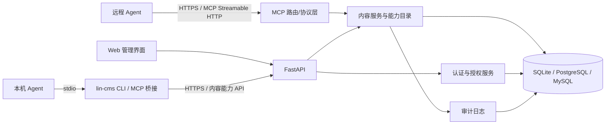

# Lin CMS Agent 接入改造：技术规格书

> 文档版本：v0.1（待评审）  
> 日期：2026-10-20  
> 需求基线：[Agent 接入改造需求澄清](./03-agent-access-requirements.md)  
> 现有基线：[规划计划书](./01-planning-proposal.md)、[实现实施方案](./02-implementation-plan.md)  
> 状态：已评审通过并实施（2026-10-20）；实施结果与落地差异见文末「15. 落地记录」。

## 1. 设计目标与约束

### 1.1 目标

构建一套供 Web UI、HTTP MCP 和本机 CLI `stdio` MCP 适配器共同使用的 CMS 内容能力服务。内容模型及内容数据可由管理员配置；用户分组可配置模型操作权限；用户拥有独立、可吊销、范围受限的 Agent Token；用户可在不学习 MCP 协议的情况下完成客户端接入。

### 1.2 不可突破的现有约束

- 保持旧 API `/cms/**`、`/v1/**`、`/health` 的路径和线格式，不更改信封 `{message, code, request}`、错误码、分页与 24 项既有权限语义。
- 后端维持 FastAPI + SQLAlchemy 同步分层，SQLite 默认，单机单进程；数据库层保持 PostgreSQL/MySQL 可移植性。
- 不新增需独立部署的 Redis、队列、缓存、搜索或工作流引擎。
- 认证、授权、Token 生命周期、审计和密钥处理为安全敏感面，必须先有测试和迁移设计。
- 单文件不超过 800 行，单函数不超过 100 行；按现有 router → service → repository → model 分层。
- 旧 Flask/Vue 参考仓库已移除；旧契约以 `docs/01` 与 `contracts/openapi.json` 的冻结内容为准。

## 2. 推荐架构



### 2.1 设计原则

1. **业务核心单一**：Web、MCP 与 CLI 只做协议/表现层适配；内容验证、CRUD、软删除、授权与审计位于后端服务层。
2. **配置数据驱动**：内容模型、字段、分组内容授权、Agent Token 范围均为持久化数据，不依赖代码常量启动同步。
3. **固定能力与动态能力分离**：旧系统 24 项权限注册表继续只管理旧权限；动态内容能力通过独立表与迁移管理。启动同步严禁清除动态授权。
4. **默认拒绝**：新内容类型默认对所有分组和 Token 不授权；HTTP MCP 的未授权工具不可见且不可调用；服务器端每次执行仍校验。
5. **向后兼容优先**：新增版本化内容能力 API 和 `/mcp` 端点，不改变旧契约。
6. **秘密最少持有**：Agent Token 一次展示；库中存摘要；CLI 不在普通配置文件存凭证；日志对授权头、Token 参数及敏感内容脱敏。

## 3. 后端领域模型

数据表采用 `lin_` 前缀和数据库通用字段类型，实际命名可在实施时与当前 ORM 风格统一。所有外键行为需要显式设计，维持 SQLite foreign_keys 与其他数据库一致。

### 3.1 内容模型定义 `lin_content_type`

| 字段 | 类型/约束 | 含义 |
| --- | --- | --- |
| `id` | Integer PK | 主键 |
| `key` | String(80), 唯一 | 稳定机器标识，小写字母/数字/连字符；创建后不可编辑 |
| `name` | String(100) | 中文显示名称 |
| `description` | String(500), nullable | 简短说明 |
| `schema_json` | Text, 非空 | 经规范化校验的字段定义 JSON |
| `status` | String(16), 非空 | `active` / `archived`；归档类型不可写入，默认仍可只读访问 |
| `create_time`, `update_time` | DateTime | UTC 时间 |

模型定义的字段 JSON 必须通过 Pydantic 严格 schema 验证；禁止 JSON Schema 中的 `$ref` 外部读取、自定义代码、SQL、模板执行或表达式求值。字段 `key` 唯一且符合受限命名格式，不能与保留元字段冲突。

字段描述：`key`、`label`、`type`（`text`/`textarea`/`number`/`boolean`/`date`/`select`）、`required`、`options`（仅 select）、可选 `max_length`/`min`/`max`。字段选项值须唯一且有限长。首发不支持字段级授权、默认值脚本、文件、密码/秘密字段、关联字段。

### 3.2 内容记录 `lin_content_record`

| 字段 | 类型/约束 | 含义 |
| --- | --- | --- |
| `id` | Integer PK | 主键 |
| `content_type_id` | Integer FK + 索引 | 内容类型 |
| `data_json` | Text, 非空 | 按当前类型 schema 校验的 JSON object |
| `deleted_token` | Integer, default 0 | 软删除标记，跨数据库一致 |
| `deleted_at` | DateTime, nullable | 删除时间 |
| `create_time`, `update_time` | DateTime | UTC 时间 |

约束与行为：

- 所有读写默认限定 `deleted_token=0`；删除设置 `deleted_token=id` 和 `deleted_at`，不物理删除。
- 数据库按 `content_type_id` 建索引。JSON 字段内基本过滤先用应用层在受限、分页后的候选范围内处理，必须避免无界全表载入；达到性能阈值时通过 SQLite/PostgreSQL/MySQL 可移植的显式影子字段/索引表另行立项，不依赖数据库私有 JSON 索引。
- 列表分页统一 0-based，`count` 默认 5、最大 15，沿用工作区 API 约束；MCP 中 `limit` 映射到该上限、`cursor` 若无稳定兼容实现则不对外提供。
- 字段新增：新字段在已有记录中缺失按可选/必要字段规则处理；如改为必填，除非已有记录补齐或提供明确迁移方案，否则拒绝保存该 schema 变更。
- 字段删除/类型收窄/枚举值移除：若会令已有记录无效则拒绝，首发不自动重写历史数据。
- 模型归档不删除记录；管理员可恢复归档。最后一个可用管理员不能使活跃内容类型无处管理。

### 3.3 动态内容授权 `lin_group_content_permission`

| 字段 | 类型/约束 | 含义 |
| --- | --- | --- |
| `id` | Integer PK | 主键 |
| `group_id` | Integer FK + 索引 | 现有用户分组，作为角色 |
| `content_type_id` | Integer FK + 索引 | 内容类型 |
| `can_read` | Boolean | 可查看/列表 |
| `can_create` | Boolean | 可新增 |
| `can_update` | Boolean | 可编辑 |
| `can_delete` | Boolean | 可软删除 |

唯一约束为 `(group_id, content_type_id)`。没有关联记录表示全部禁止。禁止 Root 旁路动态内容能力：Root 内容权限由显式分配决定。该设计避免 Root Agent Token 获得全内容访问权，也使浏览器内容工作区呈现的可用模型明确一致。Root 的现有管理员 API 旁路不变，但不覆盖新增内容 CRUD、MCP 或 Token 能力。

用户有效内容能力定义为其所有现有分组授权的并集，且需模型处于 active。Root 管理员身份不自动变成内容 ACL；Root 用户需要被加入具有相应内容授权的分组，或者由管理员显式在 Root 对应授权记录上分配权限。推荐将 ROOT 组作为可分配内容权限的一个角色，但不允许将后台系统权限暴露给 Agent。

### 3.4 Agent Token `lin_agent_token`

| 字段 | 类型/约束 | 含义 |
| --- | --- | --- |
| `id` | Integer PK | 主键 |
| `user_id` | Integer FK + 索引 | 所属用户 |
| `name` | String(100) | 用户可识别名称 |
| `prefix` | String(16), 索引 | 公开识别前缀，不含可用于认证的完整密钥 |
| `secret_digest` | String(128), 唯一 | 高熵密钥的单向摘要；不得存明文 |
| `expires_at` | DateTime, 非空 | 必须的过期时间，最长 365 天 |
| `last_used_at` | DateTime, nullable | 最近成功认证时间 |
| `revoked_at` | DateTime, nullable | 吊销时间；非空后不可恢复 |
| `create_time` | DateTime | 创建时间 |

配套范围表 `lin_agent_token_scope`：`id`、`agent_token_id`、`content_type_id`、`can_read`、`can_create`、`can_update`、`can_delete`，唯一 `(agent_token_id, content_type_id)`。未选的类型/操作默认禁止。

认证格式建议为 `Authorization: Bearer <opaque-token>`。结构使用可识别版本前缀和随机高熵 secret，例如 `lin_agent_<public-prefix>_<random-secret>`；验证时基于前缀先取候选，再执行恒定时间摘要比较。密钥随机源用 Python `secrets` 或经核验同等级 API。算法选 SHA-256 HMAC（服务端 pepper 来自 `LIN_AGENT_TOKEN_PEPPER`）或基于高熵 secret 的 SHA-256 摘要；实施阶段须比较迁移/密钥轮换要求并在规格确认时锁定，禁止用低熵密码散列替代高熵 Token 摘要。若使用 pepper，需独立环境配置且不可回退到 JWT secret 的默认值。

创建时规则：

- 默认有效期 90 天、最长 365 天且到期时间必填；配置界面不提供“永不过期”。
- 用户一次只能获取完整明文；后续列表/管理员视图永不返回完整 Token。
- Token 范围必须是 `当前用户有效内容能力 ∩ 用户明确选中能力`；若授权缩小，运行时交集即时收窄；授权扩大不扩大已签发 Token 的静态 scope。
- Root 用户不得选取管理 API 能力或自动获得全站内容能力；只能选其当前显式分组授权具有的内容范围。
- 改密、管理员重置密码、用户删除时全部吊销其 Agent Token。用户分组/角色权限变化不必改写 Token scope，因运行时 ACL 交集自然收窄。
- 每个用户同时有效 Token 数限制建议 20 个，可作为配置常量；达到上限时提示吊销旧凭证，不隐式替用户吊销。
- 最近使用时间仅在成功认证后更新；更新频率可按最小写入策略节流（例如 5 分钟内不重复写入），但不得缓存授权结果。

### 3.5 审计记录 `lin_agent_audit_log`

记录 Token ID、用户 ID、内容类型、记录 ID（若适用）、操作名、结果状态、错误类别、请求 ID、时间戳。不得记录密钥、Authorization 头、完整请求/响应正文、敏感字段值或原始异常中的 secret。可按内容脱敏策略记录字段名摘要，但首发推荐不保存字段值。审计查询只供 Root 管理员，提供分页和时间/Token/操作过滤；首发不支持导出。

保留期限：建议默认 180 天；过期清理在低频管理请求或显式维护命令中批次处理，不引入后台任务队列。保留策略长度应通过 `LIN_AGENT_AUDIT_RETENTION_DAYS` 配置，且配置需校验为正整数。审计失败不得使一个已执行的写操作对调用方显示成功但未记录；写入应与内容操作在同一数据库事务中提交。

## 4. 权限目录与授权算法

### 4.1 旧固定权限兼容

- `PERMISSION_REGISTRY` 仍覆盖原有 24 个系统权限；旧 API 的路由依赖按原样执行。
- 启动同步只能增删改代码拥有的固定权限键空间；动态内容授权存独立表，不允许进入旧 `lin_permission` 同步删除候选集。
- 旧分组页面继续管理挂载权限；新增内容操作权限独立展示为“内容访问”，但与同一分组关联，不混淆旧接口权限树。
- Root 对既有 `/cms/admin/**` 的访问旁路保留；新内容 API 与 MCP 不使用 Root 旁路。

### 4.2 内容授权伪代码

```text
用户能力 = 用户所有有效分组对指定内容类型的操作并集
Token能力 = Token 静态 scope 中该内容类型的操作
有效能力 = 用户能力 ∩ Token能力
拒绝条件 = Token 已吊销/过期/不存在，模型已归档，操作不在有效能力，记录类型不匹配，字段数据校验失败
```

Web UI 使用浏览器会话时的有效内容能力不受 Agent Token scope 限制；MCP/Agent API 必须有 Agent Token 并计算交集。普通网页登录 JWT 不得直接认证远程 MCP 或 Agent 专用 API。若以后需要交互式 OAuth/MCP Authorization，另作项目范围与威胁建模。

### 4.3 统一服务接口

建议建立 `content_type_service`、`dynamic_content_service`、`agent_token_service`、`agent_authorization_service`、`agent_audit_service`。HTTP 路由和 MCP 工具调用同一 service 方法，避免分别实现校验/授权。授权对象应显式区分 `UserSessionPrincipal` 与 `AgentTokenPrincipal`，防止把 Root 标志或后台权限意外带进 Agent 上下文。

## 5. HTTP API 规格

所有新增 API 位于 `/api/v1` 前缀，避免改动旧 `/v1/book` 契约；所有 JSON 错误沿用项目错误响应体系，新增错误码区间须在实施前登记于规格/契约。登录旧 API 的 JWT 只用于浏览器管理端新增管理操作；Agent API 使用不透明 Agent Token。管理 API 仅 Root 可访问，个人 Token 管理使用当前登录用户身份。

### 5.1 内容模型发现与管理

- `GET /api/v1/content-types/available`：当前浏览器用户或 Agent Token 可访问的内容类型，返回其有效操作集合；Agent 仅返回 Token 范围与当前分组能力交集中的模型。
- `GET /api/v1/admin/content-types`（Root）：分页返回全部内容类型，含状态与记录数量摘要。
- `POST /api/v1/admin/content-types`（Root）：新建模型，校验 `key`、字段名、保留字、字段选项及限制。
- `GET /api/v1/admin/content-types/{type_id}`（Root）：模型详情与字段 schema。
- `PUT /api/v1/admin/content-types/{type_id}`（Root）：更新名称/描述/schema；按历史记录兼容规则拒绝破坏性变更。
- `POST /api/v1/admin/content-types/{type_id}/archive` / `restore`（Root）：归档与恢复。

### 5.1.1 分组内容权限管理（Root）

- `GET /api/v1/admin/groups/{group_id}/content-permissions`：读取指定现有分组（包括隐藏于旧分组列表中的 ROOT 组）的内容类型操作授权。
- `PUT /api/v1/admin/groups/{group_id}/content-permissions`：以完整替换方式保存该分组的内容权限集合；请求以 `content_type_id` 和 `can_read/can_create/can_update/can_delete` 表示，整体事务化、幂等。遗漏的类型/操作视为撤销。
- 以上接口必须拒绝 Guest/Root 内置组的删除/身份级别变更，但允许 Root 管理员配置它们的内容 ACL。旧 `/cms/admin/group/all` 响应保持兼容，不因此暴露 Root 组。
- 内容模型管理、分组 ACL 管理只允许 Root 会话 JWT；Agent Token 与普通用户不能调用。

### 5.2 内容记录（当前用户 Session 或 Agent Token）

- `GET /api/v1/content/{type_key}`：分页列表；支持有限的标量等值过滤、排序字段白名单和升/降序。
- `POST /api/v1/content/{type_key}`：新增符合 schema 的 JSON object。
- `GET /api/v1/content/{type_key}/{record_id}`：获取详情。
- `PATCH /api/v1/content/{type_key}/{record_id}`：按字段合并更新；提交字段必须属于当前 schema，最终完整记录必须符合必填约束。
- `DELETE /api/v1/content/{type_key}/{record_id}`：软删除。

安全限制：

- 禁止任意 SQL、JSONPath、脚本、模板、动态类加载、任意文件路径及任意过滤表达式。
- 列表允许的 `filter` 为字段键到标量值映射；数量最多 5 个字段；操作只允许 equality；字符串/数组长度均有限制。
- 可排序字段仅限 schema 中 `text`、`number`、`date`、`boolean` 且实现有确定排序语义的字段；首版如应用层排序超出安全上限则不开放排序。
- 返回字段按 schema 过滤，不返回数据库内部字段或 Token 元数据；限制单记录 JSON 字节数（建议 64 KiB）和批量条数。
- 原生 JSON 解析失败、重复键、深层嵌套、非有限数值及不允许类型均拒绝。

### 5.3 用户 Agent Token（本人）

- `GET /api/v1/agent-tokens`：仅返回本人 Token 元数据，不包含摘要或明文。
- `POST /api/v1/agent-tokens`：创建 Token，返回一次性 `token` 与可安全保存的配置字段。
- `DELETE /api/v1/agent-tokens/{token_id}`：吊销本人 Token；Root 可使用管理审计能力代吊销他人 Token，但默认同一端点需显式 Root 授权并记录操作者。
- 管理员查看：`GET /api/v1/admin/agent-tokens` 只读分页元数据；`POST /api/v1/admin/agent-tokens/{id}/revoke` 吊销并审计。

不得提供“重发明文”或密钥恢复 API。

## 6. MCP 协议与工具规格

### 6.1 传输

- 远程：MCP SDK 支持的稳定 HTTP Streamable transport；端点建议 `/mcp`。协议版本、端点格式和 SDK 版本在实施时根据官方文档核验后锁定。
- 本机：CLI 以 `stdio` 运行同一 MCP 工具 schema，并通过 HTTPS 调用 `/api/v1/content/**`；不使用本地监听端口、不连本机 SQLite、不持有用户数据库密码。
- HTTP MCP 与远程内容 API 使用同一 Agent Token 认证。Streamable HTTP 的鉴权挂载方式需要以所选 MCP SDK 稳定版本的官方文档进行兼容验证；不得因协议适配绕过授权服务。
- 对 HTTP MCP 使用 HTTPS、CORS 来源白名单、Host/Origin 校验、DNS rebinding 防护；禁止通配来源配合凭据。生产反向代理的可信头与限流配置应沿用项目安全设置。
- 客户端断连/请求取消时停止后续写入；调用幂等策略和重试语义在新增写工具中明确，MCP 不自动重试写操作。

### 6.2 工具清单

1. `list_content_types`：仅返回 Token 有查看能力的 active 类型和安全摘要，不返回无权模型字段细节。
2. `list_content_records`：按内容类型分页读取；筛选和排序参数采用 API 第 5.2 的白名单。
3. `get_content_record`：读取一条有权访问的记录。
4. `create_content_record`：新增记录，需 `can_create`。
5. `update_content_record`：更新记录，需 `can_update`。
6. `delete_content_record`：软删除记录，需 `can_delete`；工具元数据应声明破坏性操作，说明删除可由管理员恢复（若 UI 提供恢复）。

每项工具需有稳定 `name`、简明 description、JSON Schema input、成功/错误结果结构、适当的风险提示。工具结果返回 `record_id`、类型 key、字段数据和时间戳，不包含完整用户主体、Token 前缀/元数据或系统错误堆栈。

### 6.3 错误映射

- 未认证、Token 过期、吊销：MCP 授权错误/HTTP 401。
- 已认证但无此模型操作：MCP 工具错误，HTTP 层按 403；响应不泄露未授权模型是否存在。
- 字段/schema 校验失败：结构化输入错误，HTTP 400。
- 资源不存在或已删除：404；无权访问和不存在的 ID 应尽可能统一对外消息以降低枚举风险。
- 限流：HTTP 429；遵守 Retry-After，工具层不得自动重试写操作。
- 服务器错误：通用错误 ID；详细异常只入脱敏服务日志。

错误码应放入 MCP `isError=true` 工具结果的机器可读 `code` 和人类可读 `message`，不得把 HTTP `200` 当作工具执行成功的唯一判据。

## 7. CLI 单文件程序规格

### 7.1 构建与发布

- CLI 为独立 Go 工程，位于工作区根 `lin-cms-cli/`（与 `lin-cms-fastapi`、`lin-cms-react` 平级；2026-10-20 用户指定语言与位置，替代原「Python 子目录」方案）。不得把服务端依赖打进 CLI。
- 通过官方支持的 Python 单文件打包工具构建 macOS arm64/x86_64、Windows x86_64、Linux x86_64/arm64 制品；正式工具与代码签名/校验和策略在实施前依据官方文档核验。
- 发布产物应附版本、校验和、源码对应版本与最小系统要求。安装方式及发布渠道（公开 GitHub Release 或内部制品库）作为交付配置确定，不得在规划中假定已拥有 PyPI 或代码签名凭证。
- 可在 `--version`、帮助信息中查看版本与协议兼容版本。

### 7.2 命令与交互

逻辑命令建议：

- `lin-cms init`：交互输入 CMS Base URL，验证 `/health`，提示输入 Agent Token，通过安全存储保存。
- `lin-cms test`：检查地址 TLS/可达性、Token、MCP 初始化和工具发现；仅调用只读能力。
- `lin-cms config`：输出通用 MCP 客户端配置 JSON；支持 stdout 输出和写入用户明确指定的路径，但不得写入 Token 明文。
- `lin-cms mcp`：运行本机 `stdio` 服务器，读取安全凭证并转发工具调用。
- `lin-cms logout`：删除所选本机凭证；不隐式吊销服务端 Token（额外明确命令需要用户二次确认）。

命令名仅为暂定，实施时根据 CLI 库和用户测试调整。交互应有逐步提示、可复制命令、明确错误修复建议；环境变量模式须适配 CI/无头容器。

### 7.3 本地凭证

凭证优先写入 macOS Keychain、Windows Credential Manager、Linux Secret Service 等目标平台的系统凭证存储；具体 Python binding/打包兼容性需官方文档核验和平台测试。若安全凭证库不可用：

- 允许用户显式选择环境变量或每次交互输入；
- 不得自动将明文写入 `~/.config`、项目文件、MCP JSON 配置、shell 历史或日志；
- 在 `stdio` 模式从环境变量读取 Token 时，对任何诊断输出隐藏值。

MCP 客户端配置片段应只含可执行文件路径/命令、CMS URL、非秘密选项和环境变量引用，不包含真实 Token。因不同客户端环境变量展开规则存在差异，生成通用配置时提供 `${LIN_CMS_AGENT_TOKEN}` 形式的占位符及如何在客户端进程环境中设置的说明，不承诺所有客户端能自动解析。

## 8. 前端模块与信息架构

新增 feature 建议：

- `features/content-types/`：类型列表、向导、字段编辑、预览、归档。
- `features/content/`：按模型动态生成的列表、表单和详情；表单 renderer 根据已验证 schema 映射基础字段组件，不执行 schema 内代码。
- `features/agent-access/`：接入方式选择、Token 验证/状态提示、通用配置复制、常见错误说明。
- `features/profile/agent-tokens/` 或独立 `features/agent-tokens/`：Token 列表、新建、一次性展示、吊销。
- `features/groups/`：分组权限编辑增加单独“内容操作”标签页，不把 dynamic permission 误放入固定 24 项清单。
- `features/admin/agent-audit/`：Root 限定的 Token 元数据与 Agent 操作审计，首发仅必要分页/筛选。

侧边栏增加“内容类型”“内容管理”“Agent 接入”；分组权限页复用现有分组选择流。Web UI 的按钮隐藏仅是易用性，不是安全边界；后端必须保证相同授权。

## 9. 安全威胁与控制

| 威胁 | 控制 |
| --- | --- |
| Token 被窃取 | 高熵随机密钥、一次展示、仅存摘要、HTTPS、支持即时吊销、限制能力和到期日 |
| Root Agent Token 权限过大 | Token 认证主体不含 Root bypass；scope 仅为显式内容能力子集；不映射系统管理权限 |
| 动态 schema 注入 | 只接受受限声明式字段；Pydantic 校验；禁止执行表达式/代码/SQL/外部引用 |
| 越权读取/写入 | 统一服务授权；每请求重查当前分组能力并与 Token 静态范围交集；ID 与类型绑定检查 |
| 枚举内容类型/记录 | 对不存在与无权资源尽量统一外部错误；工具发现只返回有权模型 |
| DNS rebinding / 浏览器来源滥用 | HTTP MCP 校验 Host/Origin、CORS 白名单、禁止任意私网代理目标；远程生产只允许 HTTPS |
| Token 出现在日志/诊断 | 请求头递归脱敏、CLI stderr/stdout 敏感值过滤、测试断言 secret 不出现 |
| Token 撤销后仍可用 | 数据库每次认证检查 revoked/expiry；不在进程缓存授权或 Token 状态 |
| 权限撤销延迟 | 当前 ACL 每请求读取；若未来使用缓存则须失效机制单独立项 |
| 资源耗尽 | 内容 schema 限制、记录大小/字段数/深度限制、分页最大 15、单 Token 与 IP 限流沿用进程内实现 |
| 审计变成内容泄漏 | 审计只存操作元数据，不存完整 request/response 内容；同事务写入 |
| CLI 明文持久化 | 系统凭证库优先，fallback 环境变量/交互，不自动降级为明文配置文件 |

## 10. API 契约和 OpenAPI 演进

- 新增 `/api/v1/**` 路径仅用于 Agent/可配置内容能力，不调整旧 API。
- 当前 `contracts/openapi.json` 由后端导出；新增路由须同步导出并由 `openapi-typescript` 更新前端类型。
- 管理 API 的成功/错误响应使用当前信封规则；内容读 API 返回明确 DTO；MCP 工具结果按协议约束组装，保持底层错误类别统一。
- OpenAPI 的 Authorization Scheme 必须分别定义浏览器 Session JWT 与 Agent Token，且写清仅后者可访问 Agent 专用 endpoint；Token 创建响应的 secret 标记一次性字段，不能通过普通 list schema 引用。
- 不改变旧错误码含义。新增错误码在 `errors.py`、OpenAPI、前端类型和测试中一并登记；MCP 错误需映射到 HTTP/MCP 错误。
- 新表使用 Alembic 向前迁移。部署应先升级数据库再启动服务；迁移需兼容现有已含 10 张表的数据，且不得删除旧权限/旧用户关系。

## 11. 验证策略与验收矩阵

### 11.1 后端单元/集成测试

- schema 字段校验：每种类型有效/无效、required、长度/范围/选项、保留字段、重复 key、深度/字节限制。
- 模型演进：新增可选字段、必要字段变更、类型收窄、字段删除、归档/恢复与历史记录行为。
- 授权：无分组、单/多分组并集、撤销即时生效、Token 静态 scope 收窄、Root 无旁路、跨用户 Token 不能操作、归档类型不可写。
- Token：一次展示、摘要存储、恒定时间比较、失效、到期、手工撤销、用户改密、管理员重置、用户删除、用户数量上限。
- 审计：成功/失败写入、和内容事务原子性、字段不包含 secret/内容载荷、分页过滤。
- MCP：初始化/工具列表、每个工具授权/拒绝、schema 不越权、错误 `isError`、取消请求、拒绝自动重试写调用。
- API 兼容：既有完整测试集通过；旧 OpenAPI 路由/响应和 24 权限不漂移。

### 11.2 前端测试与 E2E

- 内容模型向导：字段类型、必填、选项、重复字段 key、预览与服务端错误。
- 动态内容表单：根据 schema 渲染、列表筛选、创建/编辑/归档状态、空状态和无权限状态。
- 分组“内容操作”权限保存：差集/事务错误可读、权限变更提示下一次请求立即生效。
- Agent Token：创建范围限制、一次性展示、离开页面后不可恢复、吊销、过期提示。
- Agent 向导：远程 HTTPS 地址、生成通用配置、复制、只读连接测试，不泄露 Token。
- E2E 完成闭环：Root 创建类型→配置用户组能力→用户创建受限 Token→CLI 或 HTTP MCP 发现并读写→撤销授权后后续请求失败→旧系统登录/图书/用户/分组流程仍通过。

### 11.3 CLI 构建与平台测试

- macOS arm64（至少）、Windows x86_64、Linux x86_64；若不能覆盖全平台，交付清楚标记平台范围，禁止宣称跨平台全部可用。
- 干净目标环境无 Python 可运行；`--version`、`init`、`test`、`config`、`mcp`、`logout` smoke 测试。
- 系统凭证库读写/权限错误；无凭证库时环境变量/交互 fallback；配置、终端、错误日志和 shell history 中没有真实 Token。
- `stdio` 协议 stdout 仅输出 MCP 帧，日志与诊断输出到 stderr。
- 通用配置片段通过 JSON parser 校验；不包含明文秘密、不假定客户端变量插值一致。
- 制品带版本、sha256 校验和、依赖许可证信息；单文件打包中无意外包含 `.env`、数据库、测试密钥或开发资产。

### 11.4 安全与性能测试

- 越权 IDOR、参数污染、动态字段名注入、未声明字段、SQL 注入字符串、JSON 深度/体积、请求速率、Host/Origin、TLS、DNS rebinding。
- 检查应用/反向代理日志、审计、CLI stdout/stderr 不包含 secret。
- 本地 SQLite 目标：1 万条同模型内容记录，分页读取 p95 < 500 ms（开发机基准需注明设备）；如应用层 JSON 过滤达不到，缩小查询范围或暂停过滤功能，不得无界全表扫描。
- 内容最大记录体积 64 KiB；模型每种类型最多 100 个字段；下发工具 JSON Schema 不超过合理协议限制。
- 所有写入与审计在一个事务内；模拟失败确保不留下半更新状态。

## 12. 配置项建议

| 环境变量 | 默认值 | 说明 |
| --- | --- | --- |
| `LIN_AGENT_TOKEN_PEPPER` | 生产必填（若选 pepper 摘要方案） | Token 摘要密钥；独立密钥、不得记录 |
| `LIN_AGENT_TOKEN_DEFAULT_TTL_DAYS` | `90` | 新 Token 默认有效期 |
| `LIN_AGENT_TOKEN_MAX_TTL_DAYS` | `365` | 有效期上限，不得配置超过安全政策上限 |
| `LIN_AGENT_TOKEN_MAX_ACTIVE_PER_USER` | `20` | 每用户有效 Agent Token 数上限 |
| `LIN_AGENT_AUDIT_RETENTION_DAYS` | `180` | 审计保留天数 |
| `LIN_AGENT_CONTENT_MAX_RECORD_BYTES` | `65536` | 内容记录 JSON 最大字节数 |
| `LIN_AGENT_CONTENT_MAX_FIELDS` | `100` | 单模型字段数上限 |
| `LIN_AGENT_RATE_LIMIT_ENABLED` | `true` | Agent API/MCP 限流开关，进程内实现 |

实际 Pepper 方案、限流阈值、HMAC 与哈希选择、MCP SDK、打包工具和凭证库版本须在实施前根据官方文档和威胁模型确认；生产环境禁止硬编码默认密钥。若采用无 pepper 的高熵 SHA-256 摘要，删除 Pepper 环境变量且明确密钥生成熵/恒定时间比较；这两种方案只能选其一。

## 13. 风险与待确认事项

1. **MCP SDK 与协议接口变化**：在实现前核验官方 SDK 和协议文档，先做最小 HTTP/stdio 兼容性验证；确定固定版本后更新锁文件与 ADR。
2. **内容 JSON 查询性能**：SQLite 不适合作为任意 JSON 查询引擎；首发仅支持有限过滤并分页/行数上限，复杂查询单独立项。
3. **模型 schema 演进**：保存为必填的变更若与旧记录冲突，拒绝变更并展示影响记录数量；不自动破坏性迁移。
4. **Root 的内容授权语义**：既有 Root 管理 API 继续旁路；Agent 内容 API 不旁路。Root 账号本身需显式进入有内容授权的分组，确保 Token scope 能被正确限定。
5. **CLI 单文件打包与系统凭证库兼容性**：跨平台打包、签名/公证、Linux Secret Service 环境需要实际构建验证；不把签名凭证或发布账号当作已具备。
6. **通用 MCP 配置兼容性**：厂商客户端对环境变量展开和命令格式不同；通用片段只保证协议形态和安全说明，不保证一键安装到所有客户端。
7. **异步 MCP 与同步 SQLAlchemy**：协议 server 运行模型不得阻塞事件循环；选择 SDK 后采用同步线程池/专用同步执行模型并对连接生命周期做测试，不引入异步数据库依赖或队列。
8. **既有需求文档同步**：正式启动实施前应更新 `00/01/02` 中不再成立的“固定权限/无内容模型/不做插件与 Agent 接入”等摘要条款；不静默覆盖旧版本。建议保留原文档历史，在评审通过后将本新增文档作为增量基线并修订主规划的相关章节。

## 14. 落地记录（实施后回填，2026-10-20）

- **Token 摘要方案**：选定「无 pepper 高熵 SHA-256 摘要」——`lin_agent_<8位hex前缀>_<token_urlsafe(24)>`，
  库存 `sha256(token)`，认证按 prefix 取候选后 `hmac.compare_digest` 比对；§12 的
  `LIN_AGENT_TOKEN_PEPPER` 按约定**删除**，新增 `LIN_AGENT_CONTENT_FILTER_SCAN_LIMIT=1000`。
- **MCP SDK**：官方 `mcp==2.3.0`（v2 API：`MCPServer`/`@mcp.tool()`/`ctx.headers`/
  `streamable_http_app(stateless_http=True)`）；挂载 `/mcp` 子应用 + 宿主 lifespan 显式
  组合；配置 `LIN_SITE_DOMAIN` 后启用 SDK 的 Host/DNS-rebinding 防护，未配置时由 CORS 与
  反向代理承担来源策略。
- **过滤/排序**：等值过滤与排序为应用层 keyset 批扫（200/批、单请求 ≤ 1000 行），
  命中上限时响应 `scan_truncated=true`；`total` 为扫描窗口内计数。
- **发现端点**：`GET /api/v1/content-types/available` 载荷含 `fields`（字段定义）——
  表单/过滤渲染需要 schema，且读权限语义上 schema 与类型一起可见。
- **前端类型**：手写 `types.ts`/`agent-types.ts`（沿用工程既有约定），未引入 openapi-typescript。
- **用户删除**：Agent Token 行整体清理（含 scope），强于吊销；审计行无外键、保留历史。
- **CLI**：改为 **Go 实现**（用户 2026-10-20 指定），位于工作区根 `lin-cms-cli/`
  （Go 1.27 + 官方 `modelcontextprotocol/go-sdk v1.8.0` + `zalando/go-keyring v0.2.8`）；
  五命令与凭证语义与 Python 版一致（keyring 优先、环境变量 fallback、绝不写明文文件）；
  Go 交叉编译可一次产出 macOS arm64/x86_64、Linux amd64/arm64、Windows amd64 全部单文件制品。

## 15. 技术规格评审清单

- [ ] 是否接受由现有用户分组作为内容角色，不引入第二套独立 Role？
- [ ] 是否接受 Root 后台旁路继续有效，但 Root 的 Agent Token 必须受显式内容授权限制？
- [ ] 内容类型与记录是否采用声明式 schema + JSON 存储？
- [ ] 首发字段类型和有限查询是否满足用户低门槛与实际内容使用？
- [ ] 是否接受用户自有 Agent Token，默认 90 天、最长 365 天、密码重置后吊销？
- [ ] 是否接受 HTTP MCP + CLI 本机 `stdio` 桥接同一服务端能力 API？
- [ ] 是否接受 CLI 单文件跨平台发布、通用配置输出、不自动写厂商客户端配置？
- [ ] 审计字段、保留期限、记录大小/数量、平台测试范围是否合理？
- [ ] 是否接受首发不包含多租户、字段/记录级权限、审批、全文搜索、文件 Agent 上传和服务账号？

评审通过后才生成实施计划。实施计划会按依赖顺序覆盖迁移/授权底座、内容模型、Token、API/MCP、Web 向导、CLI 打包、安全测试和分阶段发布；不得在规格未批准前开始产品代码改造。
